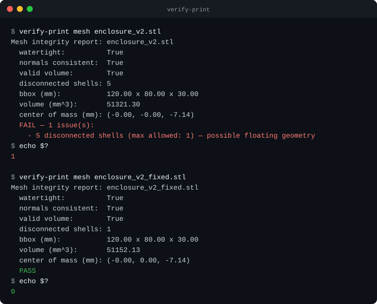

# verify-print

**Catch CAD, mesh and slicer-profile bugs before you waste filament.**

`verify-print` is a command-line tool and Python library that checks an FDM print job *before* it reaches the printer: the STL mesh, the CadQuery parameters behind it, the slicer profile, and downloaded 3MF projects. Every check is deterministic, runs in seconds, and returns a CI-friendly exit code.



<sub>Real output, not a mock-up: `python scripts/make_demo.py` rebuilds both parts and redraws this image.</sub>

Built and used in production at **Volta Tech PR**, a 3D-printing shop in Puerto Rico running a small print farm (Bambu Lab P1S, Prusa XL, Anycubic Kobra).

> *Español:* hecho y usado en producción en **Volta Tech PR**, Puerto Rico. `verify-print` revisa el modelo, los parámetros CAD y el perfil del slicer **antes** de imprimir, para no perder horas de impresión ni filamento. Las instrucciones de abajo están en inglés; los issues en español son bienvenidos.

## Why it exists

It came out of a real enclosure project at Volta Tech PR that went through four design iterations (v2.0 → v2.4). Each failed print cost 20–44 hours of printer time. Looking back, every one of those bugs was detectable on the computer first:

| Real bug | Check that catches it |
|---|---|
| Cable opening modelled on the front face instead of the back | `orientation` |
| Magnet pockets left a 0.2 mm floor that cracked | `thickness` (partial — see [design note](docs/thin-pocket-detection.md)) |
| A hollow filament profile fell back to 2 mm³/s volumetric speed: **44 h instead of 22 h** | `slice --min-speed`, `project` |
| 18 magnet parameters still defined after the magnet code was commented out | `params` |
| Alignment posts and magnet pockets indistinguishable in the slicer preview | `feature_color` (library) |
| 4 alignment posts not fused to the body: 5 disconnected shells | `mesh` |

## Install

```bash
pip install -e .                 # mesh, params, info, thickness, orientation, slice, project, compare
pip install -e ".[mesh-repair]"  # + PyMeshLab deep checks and repair
pip install -e ".[cad]"          # + CadQuery feature-color export
pip install -e ".[all]"          # everything, including pytest
```

Python ≥ 3.9. Slicing uses **Bambu Studio 2.8** (default) or **OrcaSlicer 2.3** (`--slicer orca`) installed at the standard macOS path (`/Applications/…`). Slicing on Linux/Windows is not wired up yet — the mesh, params, info and 3MF-settings checks work everywhere.

## Quick start

```bash
# Is the mesh printable? (watertight, manifold, shells, bbox, mass)
verify-print mesh part.stl

# Bbox, volume, build-volume fit and mass — no slicer needed
verify-print info part.stl --build-volume 256,256,256 --density 1.27

# Thin walls (inward ray casting)
verify-print thickness part.stl --threshold 0.8 --samples 1000

# Does the largest opening face the back (-Y)?
verify-print orientation part.stl --normal 0,-1,0 --feature cable_opening

# Parameters defined but never used (orphans) or used but never defined (ghosts)
verify-print params params.py body.py lid.py

# Real slice with gates: fail if volumetric speed < 5 mm³/s or the print exceeds 24 h
python3 profiles/bambu/flatten.py --all   # once: builds flat/ from your Bambu Studio install
B="$HOME/Library/Application Support/BambuStudio/system/BBL"
verify-print slice part.stl \
  --filament profiles/bambu/flat/Volta-PETG-Black.json \
  --process  profiles/bambu/flat/Volta-Tech-PETG-P1S-Standard.json \
  --machine  "$B/machine/Bambu Lab P1S 0.4 nozzle.json" \
  --min-speed 5.0 --max-hours 24

# Before printing a downloaded 3MF: which setting turns a 4 h part into 17 h?
verify-print project model.3mf --printer "Bambu Lab P1S 0.4 nozzle" --slice --max-hours 6

# Everything in a folder (params.py + *.py + *.stl auto-detected)
verify-print all my_part/

# Was the last change better or worse?
verify-print all my_part/ --json > before.json
verify-print all my_part/ --json > after.json
verify-print compare before.json after.json
```

Exit codes: `0` pass · `1` fail · `2` usage error. Every subcommand accepts `--json`, and every report carries a `passed` boolean.

## What each check does

**Mesh (trimesh).** Watertight, manifold, valid volume, disconnected shells, bounding box, mass and centre of mass. `thickness` samples wall thickness by inward ray casting (use the P5 percentile on noisy meshes). `orientation` finds the largest planar opening and compares its normal with the one you expect.

**Mesh repair (PyMeshLab, optional).** Self-intersections, non-manifold edges and vertices, duplicate faces, open holes; `--repair` writes a repaired STL and re-validates it.

**Slicer simulation.** Runs the Bambu Studio or OrcaSlicer CLI and reads the real numbers: print time, grams, metres, layers, and the *effective* `filament_max_volumetric_speed` after profile inheritance. Optional gates: `--max-hours`, `--max-grams`, `--min-speed`. Accepts several STLs or a folder.

**3MF project gate.** Reads `project_settings.config` and `model_settings.config` and applies 9 rules: volumetric speed < 5 mm³/s (fail), layer height < 0.16 mm, infill > 30 % or walls > 4, supports on, accelerations < 2000 mm/s², fuzzy skin on, every key the project changed versus the stock profile, unexpected printer preset, and (with `--slice`) plate time over `--max-hours` with the top-3 features eating the time.

**Parameter linter (AST).** Finds keys defined in a params dict but never read (orphans) and keys read but never defined (ghosts — a runtime crash waiting to happen). Dynamic access (`**DICT`, f-string keys) switches that dict to review mode instead of guessing.

**Feature colour (CadQuery, optional).** Exports each feature class as a separately coloured object (STLs + `colors.json`, or one GLTF/STEP), so posts and pockets look different in the slicer.

```python
from verify_print import check_mesh, lint_params, slice_stl
from verify_print.feature_color import export_features   # needs [cad]

export_features(
    {"body": (body, "#00BCD4"), "posts": (posts, "#FFD600"), "pockets": (pockets, "#E53935")},
    output_dir="out/", format="stls",
)
```

## Bundled slicer profiles

`profiles/bambu/src/` holds PETG overrides for a Bambu Lab P1S with a 0.4 mm nozzle. The Bambu Studio CLI does not resolve `inherits` in user JSON, so `flatten.py` merges them onto your locally installed Bambu system profiles into `flat/` — generated on your machine, not shipped, because those base profiles are Bambu's (AGPL-3.0). See [profiles/bambu/README.md](profiles/bambu/README.md) for the measured time differences and the CLI gotchas.

## Known limitations

- Wall thickness is statistical sampling; a very small thin spot can be missed. Raise `--samples` for tight tolerances.
- `orientation` needs an open boundary; a fully watertight mesh reports "no hole found".
- Filament weight is 0 g when the profile has no density, which makes `--max-grams` inert.
- The project gate reads all plates; plain `slice` reads `plate_1` only.
- Slicer time estimates are typically ±15–30 % off real prints; no printer calibration is applied.
- Slicer binaries are looked up at macOS paths only.
- The parameter linter does not resolve dict aliasing (`p = CASE; p["x"]`); this is an `xfail` test on purpose.
- `feature_color` works at CAD-authoring time only; it cannot re-colour an existing STL.

## Tests

```bash
pip install -e ".[dev]"
python -m pytest
```

The test suite needs no slicer installed (slicer output parsing and command building are unit-tested); PyMeshLab and CadQuery tests skip when those extras are missing. `scripts/replay_backtest.py` replays the tool over the git history of a CAD repo to see which commits it would have flagged.

## Contributing

Bug reports with the failing STL or 3MF attached are the most useful thing you can send — see [CONTRIBUTING.md](CONTRIBUTING.md).

## License

MIT — see [LICENSE](LICENSE). Optional extras keep their own licenses: PyMeshLab is GPL-3.0, CadQuery is Apache-2.0. Bambu Studio and OrcaSlicer (AGPL-3.0) are called as external programs, never bundled.

Maintained as time allows; issues and PRs are reviewed but response times vary.
